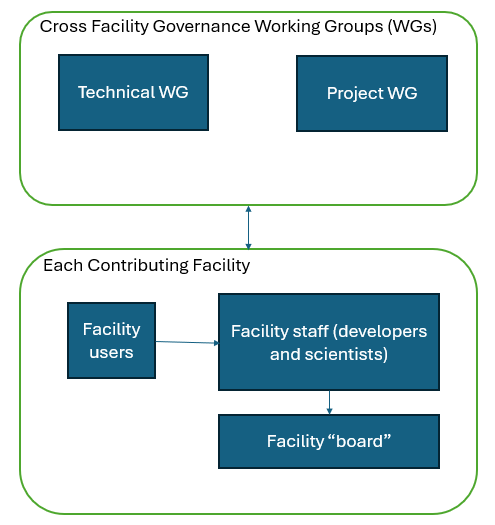
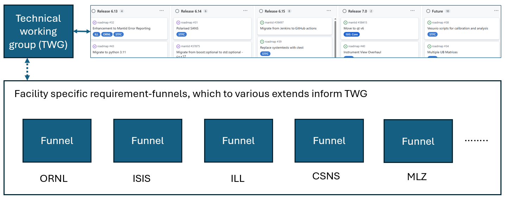
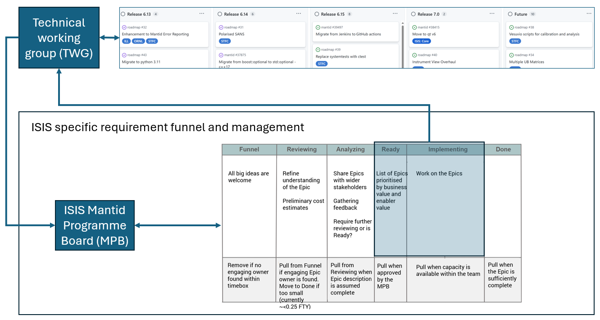

# Mantid Collaboration Governance Model

## Purpose

This document defines the governance model for the Mantid Collaboration.
It explains how participating facilities and individual contributors work together, make decisions, coordinate development, and manage shared responsibilities.
The history of the governance model is maintained in the project [history file](history.md).

## Governance model - structure

The Mantid Collaboration supports the cooperative development and maintenance of open-source scientific software.

Neutron and muon facilities that contribute to Mantid development are referred to in this document as **Contributing Facilities**.
The Collaboration is open to additional facilities that agree to the principles and responsibilities described here and commit resources to support Mantid development.

People may also contribute to Mantid without being affiliated with a Contributing Facility.
In this document, these people are referred to as **Individual Contributors**.

Contributions are not limited to source code.
Any activity that advances the goals of the Collaboration is considered a contribution.
Examples include design, testing, documentation, community support, training, and technical review.

<!--
REVIEW COMMENTS (on Fig 1):
* Pete Peterson (2026-10-26): This figure is wrong in terms of "Project WG" not being a thing mentioned in the document
* Pete Peterson (2026-10-26): Also, the working groups are not beholden to the facilities; the individual members are, to their own facility
* Anders Markvardsen (2026-10-27): Oops yes 'Project WG' meant to read 'User WG'. Having said that someone(s), I no longer remember who, suggested name Project WG from memory with the argument it could be a 'catch-all' WP name for anything not (too) technical. As currently worded in this document I personally prefer 'User WG' since it more accurately describes its focus (as currently worded).
* Anders Markvardsen (2026-10-27): About 'Also, the working groups are not...' sounds important to mentioned somewhere in e.g. this section
-->

**Fig 1.**

Figure 1 illustrates how the cross-facility governance structure interacts with each Contributing Facility.

The cross-facility governance structure consists of two Collaborative Working Groups that interfaces with each Contributing Facility, which has its own local stakeholders (developers, scientists, managers and users) and a local decision-making body responsible for prioritising Mantid-related work.

The structure and operation of the local decision-making body may vary significantly between facilities.
For example, it may be a single developer meeting informally with scientists to discuss priorities, or it may be a formal committee representing multiple scientific areas and instruments.
This governance model does not prescribe how local governance should be organised.
However, each facility is expected to maintain effective communication with the Collaborative Working Groups, as described in this document.

The two Collaborative Working Groups are:

* **Technical Working Group (TWG).** The Technical Working Group focuses on shared technical matters.
* **User Working Group (UWG).** The User Working Group focuses on user engagement.

## Responsibilities of Contributing Facilities

Contributing Facilities must:

* Provide development resources appropriate to their use of Mantid.
* Maintain local management, requirements gathering, and development processes.
* Nominate representatives to the Collaborative Working Groups.
* Support Mantid as FLOSS.
* Follow development workflows and code-quality standards established by the Technical Working Group.
* Contribute to maintenance, testing, and long-term sustainability activities.
* Consider suggestions and contributions from Individual Contributors while maintaining compliance with their own institutional policies and legal obligations.

Contributing Facilities are expected to:

* Contribute to shared infrastructure costs where appropriate.
* Maintain sufficient expertise and development capacity related to Mantid.
* Participate in User Meetings and Developer Workshops.
* Communicate major plans, requirements, and concerns to the broader Collaboration.

Mantid operates as a collaborative do-ocracy.
Facilities are free to invest effort according to their own needs and priorities.
Responsibility for delivering facility-specific functionality remains with the facility that requests or commits to that work.

## Common to both Working Groups

<!--
REVIEW COMMENT (on "Common to both Working Groups"):
* Anders Markvardsen (2026-10-27): review have voting is done and if it should more explicit?
-->

Both Working Groups operate on a consensus-driven basis and share the principles set out below.

The primary purpose of each Working Group is to provide a forum where facilities can coordinate activities, share information, identify opportunities for collaboration, and address matters of common interest.

### Membership

Each Contributing Facility may nominate up to two members to each Working Group.

New members are approved by the existing members of the respective Working Group.

A Contributing Facility is defined as a facility that either:

* Employs dedicated Mantid developers, whether full-time or part-time, or
* Funds another Contributing Facility to perform Mantid development and maintenance on its behalf.

Working Group meetings are open to guests. Guests may include:

* Individual Contributors
* Subject matter experts
* Interested facility staff
* Prospective members wishing to learn more about a Working Group

Guests may participate in discussions but may not vote on Working Group decisions.

Guests may request to attend meetings directly or may be invited by an existing Working Group member.
The Chair should be informed of invited guests before the meeting, and the Secretary should distribute a list of expected guests in advance.

All contributors are encouraged to advance their own interests and priorities while remaining mindful of the broader needs of the Mantid user community.

### Officers

Each Working Group shall elect:

* A Chair
* A Secretary

<!--
REVIEW COMMENT (on "A Chair"):
* Anders Markvardsen (2026-10-27): Should the role of a deputy be defined? And maybe have that deputy role is expected to take on the role of chair after a xyz period of time
-->

The Secretary may be a non-voting participant.

### Responsibilities of the Chair

* Act as the lead coordinator for the overall direction and health of the Working Group.
* Resolve conflicts that cannot be resolved by consensus.
* Call regular meetings of the Working Group, unless this is delegated to the Secretary.
* Check at each meeting that the membership list is up to date.

### Responsibilities of the Secretary

* Arrange regular meetings and circulate agendas, unless this is done by the Chair.
* Write meeting minutes that record decisions and provide a brief summary of discussions.
  Minutes should be understandable to the Working Group’s main audience.
  For example, the TWG minutes should be understandable to Mantid developers.

### Responsibilities of all members

* Communicate their facility’s interests and intentions to the Working Groups.
* Communicate Working Group discussions and outcomes back to their facility management.
* Be open to discussion and work towards consensus-based solutions that support commonality across the Collaboration.
* Attend Working Group meetings regularly, or send a delegate when attendance is not possible.

### Responsibilities of Each Working Group

Each Working Group is responsible for:

* Maintaining an up-to-date, publicly accessible membership list
* Holding regular meetings with agendas and minutes
* Periodically electing a Chair and Secretary

<!--
REVIEW COMMENT (on "Periodically electing a Chair and Secretary"):
* Anders Markvardsen (2026-10-27): Be specific about the time period of these (from TWG)
-->

### Escalating a major conflict between members

If the Collaboration reaches an impasse, the Working Group Chairs will document the issue and prepare a summary for all participating facility directors.
The directors will then be invited to mediate or arbitrate the issue in a joint meeting with members of the Working Groups.
If mediation does not resolve the dispute, the directors will arbitrate and make a final decision to break the deadlock.

## Technical Working Group (TWG)

The Technical Working Group provides leadership and coordination for shared technical aspects, including:

* Common software architecture
* Shared infrastructure
* Technical standards and practices
* The **Committed Collaborative Roadmap (CCR)**
* developer workshops
* Cross-facility technical coordination

### Committed Collaborative Roadmap (CCR)

The Committed Collaborative Roadmap (CCR) is the shared roadmap used to make significant committed work visible across the Collaboration.

The CCR contains two broad categories of work items:

* Large maintenance and sustainability work items that keep Mantid operational and fit for the future.
  When one or more facilities commit resources to such a work item, or when an Individual Contributor undertakes the work, it can be associated with a future release on the CCR.
* Large work items that enhance Mantid with new user-facing capabilities.
  Work items of this kind appear on the CCR once one or more facilities have committed resources to them and the TWG has been informed.
  Making such work visible on the CCR helps the whole Collaboration see what is planned.
  Scientific technique areas include, but are not limited to, powder diffraction, single-crystal diffraction, engineering diffraction, disordered materials, small-angle neutron scattering (SANS), reflectometry, spectroscopy, and muon spin rotation.

Some work items may fit both categories.

**Fig. 2.**

Figure 2 shows the connection between the TWG and the CCR and the TWG and Contributing Facilities.
The up-to-date CCR is available [here](https://github.com/orgs/mantidproject/projects/47).

Topics/work items on the roadmap should be detailed enough and written to support useful discussions.

### Specific to TWG membership

Nominated TWG members should be senior technical staff who are involved in local core Mantid work, or who have oversight of local facility Mantid roadmap needs, such as facility Mantid team leads.
Members must have the authority to discuss and agree contributions to collaborative work.

This WG operates the membership mailing list: [twg@mantidproject.org](mailto:twg@mantidproject.org).

### Responsibilities specific to all TWG members

* Attend Developer Workshops.
* Are encouraged to attend User Meetings.

### Responsibilities specific to the TWG Chair

* Ensures the CCR gets discussed and updated at each TWG meeting.
* Checks at each regular TWG meeting that the TWG mailing list is up to date.
* Attends User Meetings.

### Responsibilities specific to the TWG

* Maintain and update the CCR.
* Communicate relevant CCR items to local facility management and communicate relevant local facility priorities back to the TWG.
* Provide technical feedback on items brought to the TWG.
* Promote consensus on infrastructure and processes.
* Coordinate and advise on major designs.
* Coordinate changes to Mantid’s third-party dependencies and make recommendations on changes and updates.
* Ensure there is an appropriate distribution of developers with administrator privileges for shared services.
* Act as an arbitration and triage point for code and code-review conflicts.
* Oversee, resource, and schedule large-scale refactoring work.
* Meet online at least monthly.
* Organise the annual face-to-face Developer Workshop and, optionally, virtual Developer Workshops.

## User Working Group (UWG)

<!--
REVIEW COMMENT (on "User Working Group (UWG)"):
* Anders Markvardsen (2026-10-21): perhaps while this working group is pending specify this explicitly. E.g. change 'User Working Group (UWG)' to '(pending) User Working Group (UWG)'
-->

A user here refers to a person involved in collecting, treating, reducing, or interpreting instrument data.
This includes instrument scientists.

The User Working Group focuses on user engagement, including:

<!--
REVIEW COMMENT (on "The User Working Group focuses on user engagement, including:"):
* Anders Markvardsen (2026-10-27): Add bullet point or elsewhere, something about working between this UWG and TWG ongoing. E.g. before a facility embark on increasing scope by adding e.g. McStas as a dependency there is discussion with TWG on the technical implications of something like this, and a shared resolution on the matter.
-->

* Run and own the User Meetings.
  The UWG may identify new ways to stimulate user engagement and cross-facility discussion of user requirements.
* Support the exchange of information between users and developers not covered by the TWG.
* Find ways of making completed work and ideas by each facility more visible (beyond committed work being visible on the CCR board).
  To help identify opportunities for collaboration on scientific requirements and encourage reuse of work already completed at one facility.

The UWG is not responsible for:

* The UWG is not responsible for defining a common scientific roadmap for all facilities.
  Previous attempts to create such a roadmap showed that facility priorities differ too much for this to be practical.

UWG activities aim to assist users to understand the current state of Mantid across facilities, identify whether new user requirements would benefit from shared effort, and reveal whether similar work has already been completed elsewhere and could be reused or adapted.

Although the TWG and UWG are designed to be as independent as is practical, regular information flow between these is important.
One approach is for one TWG member to attend UWG meetings and for one UWG member to attend TWG meetings.

<!--
REVIEW COMMENT (on "Although the TWG and UWG are designed to be as independent..."):
* Anders Markvardsen (2026-10-27): If urgent issues arrises extra meeting can be arranged. Perhaps period meetings between UWG and TWG and/or these done as part of Developer/User meetings?
-->

### Specific to UWG membership

Nominated UWG members should ideally bring a mix of backgrounds and experience, because improving user-user and user-developer communication is a complex, multi-faceted challenge.
Suitable members may include instrument scientists or facility users with an interest in software development, developers with a strong interest in one or more scientific technique areas, and staff with relevant communication experience.

<!--
REVIEW COMMENT (on "Nominated UWG members should ideally bring a mix..."):
* Anders Markvardsen (2026-10-27): Perhaps UWG membership 'roles' could be different from the TWG membership setup? Perhaps members of UWG don't need to be from contributing facilities? Maybe don't need two members from each institute?
-->

### Responsibilities specific to all UWG members

* Attend events organised by the UWG.

### Responsibilities specific to the UWG Chair

* Ensure user communication is discussed at each UWG meeting.

### Responsibilities specific to the UWG

* Meet periodically.
* Organise collaboration events such as User Meetings.

## Developer Workshops and User Meetings

The following sections describe the cross-facility workshops and meetings referred to above.

### Developer Workshop

The Developer Workshop is an annual meeting organised by the TWG.
It should be face-to-face where possible, so that developers can meet in person.
It may be organised alongside a User Meeting.

The purpose of the Developer Workshop is as follows:

* Promote interaction between developers, from both Contributing Facilities and Individual Contributors.
* Run code camps to work on backlog issues (defined by the TWG) or issues that benefit from a more interactive approach to problem solving.
* Discuss new technologies and infrastructures which may be leveraged to enhance the Mantid framework.
* Gather feedback on day-to-day working practices and identify points for improvement.

### User Meeting

The User Meeting is organised by the UWG.
It should be face-to-face where possible, so that users, facility user representatives, and developers can meet in person.
It may be organised alongside a Developer Workshop.

The purpose of the User Meeting can include:

* Promote communication and connection between contributors and users of Mantid and applications built using the Mantid framework.
* Provide updates from each Contributing Facility.
* Provide updates from the UWG and TWG.
* Share recent news and individual presentations.
* Discuss new technologies and infrastructure that could enhance the user experience.

## Illustration: interactions between a Contributing Facility (ISIS) and the TWG

<!--
REVIEW COMMENT (on this section heading):
* Anders Markvardsen (2026-10-21): Optional section, perhaps delete or copy to separate page
-->

At ISIS, requirements for Mantid development are captured as Epics, which represent large units of work.
These Epics are collected from many sources across the facility and displayed on an internal requirements funnel.
The funnel is implemented as a Kanban-style board with defined workflow states such as Funnel, Ready, Implementing, and Done.

Decisions about which Epics progress to the Ready state are made by the ISIS Mantid Programme Board (MPB).
Once an Epic is committed, it becomes part of ISIS’s formal plan of work.
These committed Epics are then communicated to the TWG, where they are made visible on the CCR.

**Fig 3.** This figure expands Figure 2 for the case of ISIS.
Communication from the TWG to the ISIS Mantid Programme Board includes information about collaborative large maintenance work items and new user-facing capabilities of interest that other facilities have committed resources to.
An schematic Epic Kanban system (add link e.g. to <https://github.com/EpicKanbanSystem>) is shown at the bottom right of the figure.
Green column headers show the states an Epic can be in.
White text areas provide additional context.
Grey boxes at the bottom describe how Epics can move between columns.
FTY (another way to write FTE) stands for Full Time Year; 0.25 FTY is equivalent to one person working for three months.
ISIS TWG members ongoingly inform the TWG about committed Epics in the Ready state and as relevant other Epics too.
